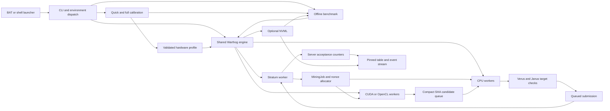

# BRminer project knowledge graph

Source snapshot: working tree, 2026-11-02. This map follows the shared Windows
and Linux Warthog implementation and dependencies pinned in CMake.

## Component graph

ConnectCoin modes branch separately from `src/main.cpp`:
`CONNECTCOIN_POOL` uses `src/connectcoin_pool.cpp`; the default runs embedded
Core. They share the executable/build, with independent workers and protocols.

## Data and control contracts

| Edge | Contract and source |
| --- | --- |
| Launcher → options | `mining-warthog.bat` / `.sh` invokes one command. `src/miner_options.hpp` parses endpoint, wallet, threads, backend and tuning controls; compatible environment settings remain supported. |
| Options → engine | `src/warthog_stratum.cpp` validates settings, selects CUDA/OpenCL/CPU, resolves a matching profile, and starts network, CPU and GPU workers. Explicit settings constrain calibration. |
| Pool → job | Plain Stratum TCP uses Winsock or POSIX sockets. Seven notify fields: job ID, previous hash, merkle prefix, version, target, timestamp, clean flag. |
| Notification → header | `buildJob` forms 80 bytes: previous hash 0–31, encoded target 32–35, SHA256 of merkle prefix + extranonce1 + extranonce2 at 36–67, version 68–71, timestamp 72–75, nonce 76–79. Nonces are little endian. |
| Job → GPU | `src/warthog_cuda.cpp` compiles for the reported architecture with compatible NVRTC. `src/warthog_gpu.cpp` provides OpenCL. Workers emit compact nonce/SHA-word candidates; feedback adjusts candidate pressure. |
| Candidate → CPU | Workers consume batched candidates with their originating job, compute Verus/Janus targets and discard stale work. Empty queues allow direct CPU mining. `src/warthog_pow.cpp` dispatches optimized/portable hashing by instruction support. |
| Solution → server | Found, submitted and accepted are distinct events. `mining.submit` sends job ID, extranonce2, timestamp and nonce. Only a positive server response increments acceptance. |
| Nonce exhaustion → work | Live mining advances extranonce2 and rebuilds the latest pool job. Offline benchmarking advances its deterministic fixture epoch. |
| Runtime → console | `src/warthog_console.cpp` pins one table and scrolls events below it on Windows/Linux terminals. Redirected output uses snapshots. Janus is primary; SHA and Verus rates support it. |
| Driver → sensors | `src/gpu_monitor.cpp` dynamically loads NVML. Missing readings show N/A and export JSON null. Monitoring is optional. |

## Benchmark and calibration

| Component | Role |
| --- | --- |
| `src/warthog_benchmark.cpp` | CLI, versioned JSON and interval-weighted statistics. The engine's `runBenchmark` reuses real workers with deterministic work and CPU-checked GPU candidates. |
| `src/quick_calibration.cpp` | Measures Verus, GPU SHA and pinned transfers, probes launch dimensions, seeds the filter and screens combined Janus throughput. A 1%+ challenger is confirmed in reverse order before selection. Produces a provisional hardware plan. |
| `src/calibration.cpp` | Caches provisional plans by hardware identity and validates fallbacks/finalists twice for five measured minutes each. Correctness, stability and repeatable gains gate the higher-trust profile. |
| Profile identity | CPU/threads, OS, GPU UUIDs/architectures, driver, compiler/builtins hashes, build and manual constraints form the key. Invalid/stale profiles trigger fresh automatic quick tuning or, when disabled, portable fallbacks. |
| `src/platform.cpp` | Library loading, executable location, CPU/OS identity, environment lookup and atomic text replacement. |

See [commands and cache rules](benchmark-calibration.md) and
[Linux build and coverage](warthog-portability.md).

## Build and verification

CMake requires C++20 and pins ConnectCoin Core
`ff459a92dab40607cda4d92c6effdb85600ceea7` and JanusMiner
`8d13b2bad00bde6ae10195f30ba3bec8824fd1cb`. Core requires Boost headers;
Linux native hashing links OpenSSL Crypto. `warthog_mining` contains the
shared engine; `brminer_platform` contains platform/monitoring support.

The native Verus object and generated optimized Verus source compile with
their vector flags. Baseline `src/native_cpu_features.cpp` checks CPUID and OS
vector support before calling AVX2 code. The Verus preparation/compatibility
CMake scripts must track pinned upstream source changes.

| Verification | Scope |
| --- | --- |
| Hash/equivalence tests | Known answers, optimized/portable equivalence, native batching and concurrent use. |
| GPU tests | CUDA/OpenCL output versus CPU, filtering and overflow/retry. CUDA execution requires `BRMINER_NVRTC_DLL`; missing runtimes/devices explicitly skip execution. |
| Config/calibration/benchmark | CLI constraints, profile/gain policy, atomic replacement, JSON statistics and CPU benchmark execution. |
| Monitor/console | Optional NVML, unavailable readings, formatting and actual console/PTY scrolling and resizing. |
| Stratum lifecycle | Synthetic jobs, acceptance/rejection, disconnect/reconnect and signal shutdown; separate from real-node acceptance. |
| Linux CPU emulation | Optional QEMU Intel Nehalem and AMD Opteron feature sets without AVX; correctness coverage only. |
| Release smoke | `scripts/verify-release.py` checks fresh extraction with CPU or a separately installed CUDA compiler, optional alternate installed compiler, operation without NVML and relocated profile loading. |

`scripts/package-release.ps1` builds/tests Windows Release, then packages
libraries, generic launchers, documentation and notices.
`scripts/linux/package-release.py` packages a separately tested Linux ELF.
Both write archive checksums; personal solo launchers are excluded.
[The acceptance checklist](development-goal.md) records actual evidence and
untested physical hardware.
