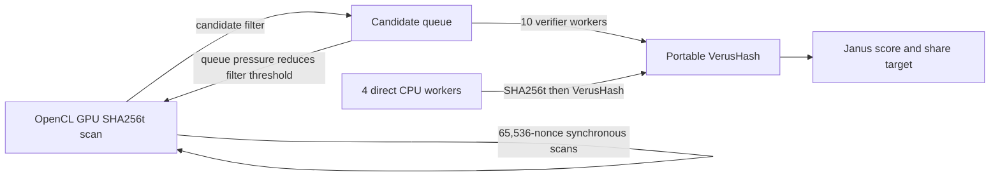

# Warthog performance baseline and bottleneck analysis

Recorded 2026-11-01 from the local Windows x64 Release build at fork commit `42688586ea70895656439e44dd5fa8da29819300`, including the source-build fixes and optional `BRMINER_BENCHMARK_TELEMETRY=1` counters in the working tree. A later direct check used the published V.3 executable. These are **interrupted comparisons**, not the requested two alternating 15-minute runs per miner. All miners were stopped at the user's request.

## Test conditions and measurements

- Host: Ryzen 7 5800X (8 physical cores, 16 logical threads), GeForce RTX 4060.
- Both miners ran alone against the same local Warthog Stratum endpoint, payout address, and pool difficulty near `1,581,733,920,120`. Both were configured for **14 CPU threads**. BRminer allocates 4 of those to direct nonce mining and 10 to GPU candidate verification; BzMiner reported 14 Verus workers.
- BzMiner v100.60 completed 900.25 seconds. BRminer was stopped after its 410-second telemetry sample. Each mean below excludes the first 120 seconds; the usable windows are therefore about 13 and 5 minutes, respectively. NVIDIA GPU utilization and temperature were sampled every 10 seconds.
- BzMiner reported one accepted share and no rejected shares. BRminer reported zero of either during its shorter run. At this difficulty, those counts are too sparse to estimate hashrate. BzMiner's console reports a 2% Warthog developer fee, which matters for payout comparisons but does not explain the measured raw speed gap.

| Post-warmup mean | BzMiner, 15 min | BRminer, interrupted | Bz / BR |
| --- | ---: | ---: | ---: |
| GPU SHA256t | 1,016.53 MH/s | 319.86 MH/s | 3.18× |
| CPU VerusHash | 24.84 MH/s | 0.177 MH/s | 140.18× |
| Combined Janus score | 478.14 MH/s | 6.97 MH/s | 68.65× |
| GPU utilization | 95.95% | 49.10% | — |
| GPU core temperature | 79.14 °C | 62.17 °C | — |

BRminer also reported about 0.058 MH/s of direct CPU SHA256t. Its normal `HASHRATE` column is CPU plus GPU **SHA256t**, not the combined Janus score; the optional telemetry prints `cpu_sha_hps`, `gpu_sha_hps`, `verus_hps`, and `janus_hps` separately (`src/warthog_stratum.cpp`). BzMiner's GPU `s`, CPU `v`, and summary `miner hr` rows were used for the corresponding components. Both rates were stable after warmup in their available windows, but the planned alternating repeats are still needed before making a final benchmark claim.

Raw console logs, 10-second GPU samples, metadata, and the summarizer are in ignored `out/bench/` on this machine. The BRminer runner was interrupted before writing its final stop metadata, but the process was verified stopped. The figures above come from `out/bench/summary.json`; that directory is not part of the tracked source tree.

### Direct published V.3 release check

The published [V.3 release ZIP](https://github.com/Brage321/BRminer/releases/tag/V.3) was already present in the user's Downloads folder. Its 1,371,083,764-byte ZIP matched GitHub's SHA-256 digest `256464abea75b06eb84b9e27ad948de9935d1827d901598e5893ea162cfd96f6`. The extracted `brminer.exe` matched the ZIP entry byte for byte (SHA-256 `11497c87746a9cb6a033bdfbec0fb30a621fb9e67b0d4fec09d10efef78a5a7a`). The test executed that exact file directly from `the local extracted V.3 release folder`, with the same local node, payout address, and 14-thread setting. The run was stopped at the user's request after its 640-second console sample; all miner PIDs were verified stopped.

| Post-warmup mean | BzMiner, 15 min | Published BRminer V.3, ~10m40s | Ratio |
| --- | ---: | ---: | ---: |
| GPU SHA256t / BRminer total SHA256t | 1,016.53 MH/s | 349.47 MH/s | 2.91× |
| CPU VerusHash | 24.84 MH/s | ~0.202 MH/s | ~123× |
| Combined Janus score | 478.14 MH/s | ~7.93 MH/s | ~60.3× |
| GPU utilization | 95.95% | 51.47% | — |
| GPU temperature | 79.14 °C | 61.94 °C | — |

Both miners exclude the first 120 seconds. BzMiner has 77 post-warmup console samples; V.3 has 53. V.3 prints only combined CPU+GPU SHA256t and a rounded average share interval. We estimated Janus as displayed pool difficulty divided by displayed interval, then inverted the exact Janus formula in its source to estimate VerusHash. Applying the same calculation to the instrumented source run gave a mean absolute sample error of 0.51% for Janus and 0.53% for Verus, with maxima under 0.85%. V.3 GPU SHA256t is approximately its total SHA256t: the source build's direct CPU SHA contribution was only ~0.058 MH/s. These are estimates, not counters emitted by the V.3 executable. V.3 stayed connected and reported 0 accepted and 0 rejected shares; zero shares in this window is expected at the assigned difficulty and says nothing about share validity.

The upstream `main` commit was checked on GitHub after the run: [`42688586ea70895656439e44dd5fa8da29819300`](https://github.com/Brage321/BRminer/commit/42688586ea70895656439e44dd5fa8da29819300). Its last change only removes an outdated executable. The Warthog source issues below remain present at that commit. The V.3 release miner and current source build have identical `src/warthog_pow.cpp`; their GPU and Stratum differences are the local OpenCL source string packaging and optional measurement output, respectively. The release's 9–14% higher rates than the shorter source run are not enough to attribute to a specific build or thermal cause; both are in the same poor performance range.

## Source-backed diagnosis

1. **CPU verification is the main Janus bottleneck.** `src/warthog_pow.cpp:83` constructs and finalizes a fresh JanusMiner `VerusHasher` for every candidate. The pinned JanusMiner source used in this build includes `verus_clhash_port.hpp`; its active `write()` and `finalize()` paths call the portable Haraka and VerusCLHash functions. The optimized selector code is commented out in `verushash.cpp`. Each finalize constructs a new `HashKey`, whose seed expansion runs 276 Haraka256 rounds (`verus_constants.hpp` and `verushash.cpp`). The MSVC compatibility patch makes `can_optimize()` false, but the active hash path uses portable functions regardless of that flag. These are concrete reasons to investigate the Verus implementation and per-candidate key setup. The ~123–140× observed gap is larger than the 14-versus-10 Verus worker allocation alone could explain. An isolated profiler measurement is still needed to assign exact percentages to each function.
2. **Slow verification feeds back into GPU work.** `src/warthog_stratum.cpp:576-629` stops the GPU worker when the candidate queue exceeds 65,536 entries and reduces the candidate threshold as the queue grows. BRminer's 0.177 MH/s Verus rate was only about 0.055% of its GPU SHA rate. The adaptive filter can keep the queue bounded, but it cannot compensate for a slow Verus stage in the Janus score. Queue occupancy and threshold were not recorded, so the amount of GPU idle time caused by backpressure remains unmeasured.
3. **GPU dispatch leaves measurable headroom.** `src/warthog_gpu.cpp:224-274` processes 65,536 nonces per call, uploads the same header with a blocking write, resets the output counter with another blocking write, waits for `clFinish`, then performs blocking result reads. The GPU worker cannot overlap the next batch with those operations. BzMiner's console reports a precompiled RTX 4060 CUDA kernel, two overlapping streams, pinned downloads, and 127 MB result buffers per stream. BRminer's roughly 49% GPU utilization and lower temperature are consistent with dispatch or backpressure stalls, but utilization alone does not separate those causes from kernel efficiency.
4. **Thread parity was configured, but the work split differs.** `src/warthog_stratum.cpp:793-804` assigns 4 BRminer threads to direct CPU SHA and 10 to GPU verification when `BRMINER_THREADS=14`; BzMiner reports 14 AVX2+VAES Verus workers. A follow-up comparison should preserve the same total CPU budget and also examine a BRminer configuration that devotes all CPU workers to the GPU candidate stream. That requires a source change or a dedicated diagnostic mode; there is no current setting for it.
5. **Per-candidate queue synchronization may consume CPU time.** `takeGpuCandidate` holds the shared mutex for every deque pop and calls `notify_all()` after every candidate, even when the queue is well below its capacity (`src/warthog_stratum.cpp:196-206`). At ~0.2 million verified candidates per second, this is a high-frequency path. Its exact cost has not been profiled, so treat it as a hypothesis to measure rather than an established share of the slowdown.
6. **The release status hides the rate that determines reward odds.** The V.3 `HASHRATE` column prints CPU+GPU SHA256t, while `AVG SHARE TIME` uses the unprinted Janus score (`src/warthog_stratum.cpp:833-902` in the pinned upstream commit). The release also does not print separate GPU SHA and CPU Verus rates. This made a ~349 MH/s display correspond to only ~7.9 MH/s of Janus score and prevents direct stage-level diagnosis from release logs.

## Contribution order

1. Preserve known Warthog hash vectors and GPU/CPU candidate agreement. Profile a stand-alone VerusHash candidate loop under the Release build, then evaluate an optimized AVX2/VAES implementation with a portable fallback. Verify byte-for-byte outputs before assessing speed.
2. Add benchmark-only counters for candidate queue depth, adaptive threshold, time spent scanning on the GPU worker, and time waiting for queue capacity. This will distinguish GPU synchronization overhead from verifier backpressure without changing consensus behavior.
3. Once the CPU stage can consume more candidates, test larger GPU batches and overlapping OpenCL operations. Measure GPU SHA, CPU Verus, and Janus score together; optimizing GPU SHA alone may produce little Janus gain while Verus is saturated.
4. Resume the originally requested alternating 15-minute runs only when the user asks to mine again. Keep the same node, address, 14-thread CPU budget, hardware, and warmup exclusion, and record all four runs separately.

## Reproduction and limits

The source build and four CTest targets passed on this machine before the live comparison; see [the build baseline](knowledge-graph.md#verified-source-build-baseline). The OpenCL test compared actual RTX 4060 results with CPU SHA256t results. The live BRminer run connected to Stratum and received a job. It did not submit a share before it was stopped, so this run does not independently prove pool acceptance. The BzMiner console rates are reported by a closed-source miner; their precise internal accounting was not independently audited. The measurements are therefore a useful performance baseline and a prioritized diagnosis, not a completed four-run verdict.
